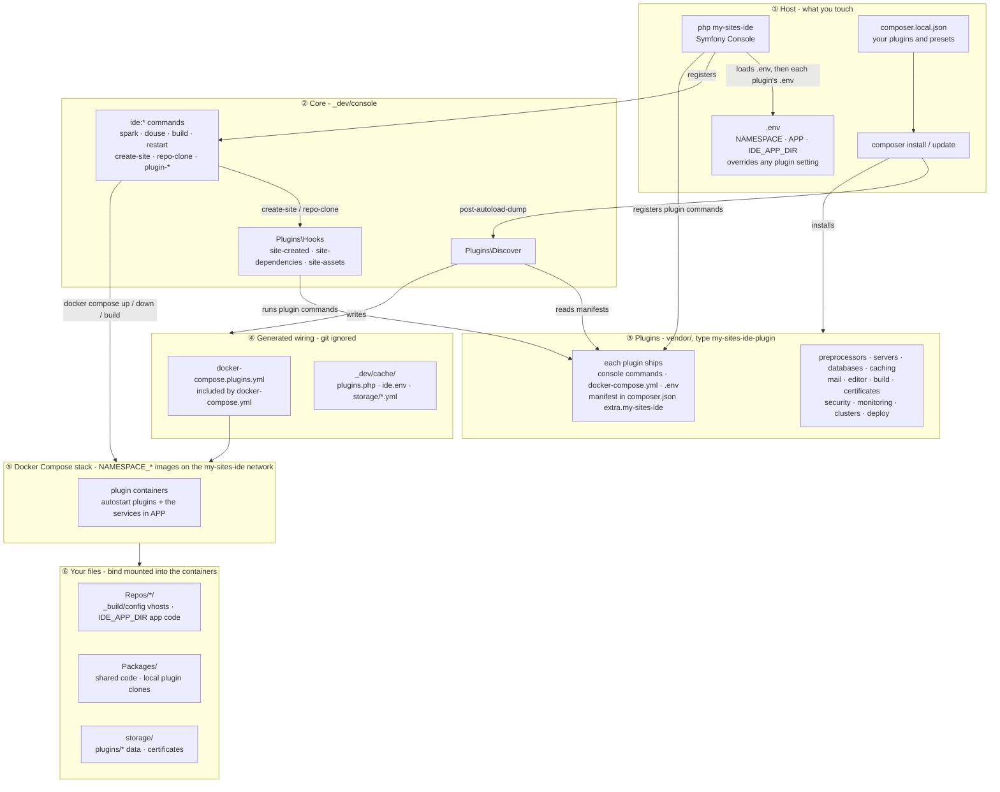

# My Sites IDE: Pluggable DevEx Infrastructure

An open-source, modular development platform for PHP sites. Every service - PHP, web servers, databases, caching, mail, a browser IDE, observability, security scanning and Kubernetes deployment - is a Composer plugin, wired into Docker Compose automatically, so each installation runs exactly the stack it needs.



The runtime view - which containers talk to which - is in [Architecture](docs/architecture.md).

## 🚀 Core Capabilities

* **Pluggable container ecosystem:** PHP-FPM/CLI, nginx, Apache or Caddy, MySQL or MariaDB, Redis and MailHog, each a plugin you opt into. Images are small (< 200mb) and the same ones run locally, in CI and in production. Installations are sandboxed from each other by `NAMESPACE`.
* **Local Kubernetes and deployment:** a Minikube cluster that mimics DigitalOcean Kubernetes (DOKS), and a Helm-based deploy plugin that builds production images, pushes them to a registry and deploys to either.
* **Browser IDE with AI tooling:** Theia in the browser with PHP, Composer, Xdebug and Claude Code built in, its settings persisted across rebuilds.
* **Observability & SecOps:** a drop-in telemetry pipeline (Grafana, Loki, Prometheus, Tempo, with Alloy taking OpenTelemetry from your apps), OWASP ZAP security scanning, Trivy scans of each plugin's Docker images on pull requests, and real Let's Encrypt certificates through Cloudflare DNS.

## 🛠️ Architecture & Plugin Hooks

A plugin is a Composer package of type `my-sites-ide-plugin`. On `composer install`/`update`, Composer's `post-autoload-dump` event runs `Plugins\Discover`, which reads each plugin's manifest and generates `docker-compose.plugins.yml`. The Symfony Console CLI then registers the plugin's commands, loads its `.env` defaults under the root `.env`, and runs its hooks on IDE lifecycle events - no core file is edited.

The manifest lives in the plugin's own `composer.json`. This is how the Apache plugin writes a vhost for every new site:

```json
"extra": {
    "my-sites-ide": {
        "commands": "src/Console",
        "compose":  "docker-compose.yml",
        "services": ["apache"],
        "hooks":    { "site-created": ["servers:apache-vhost"] }
    }
}
```

Hooks cover `site-created` (vhosts), `site-dependencies` (Composer installs) and `site-assets` (npm builds). The full contract is in [Writing a plugin](docs/writing-a-plugin.md).

## Quick start

```
git clone git@github.com:yiendos/my-sites-ide.git && cd my-sites-ide
cp env-example .env
cp composer.local-example.json composer.local.json    # the default stack: PHP, nginx, MailHog, MySQL, Redis
composer install
php my-sites-ide ide:build && php my-sites-ide ide:spark
```

Then open https://default.localhost/ - and `php my-sites-ide ide:create-site example` for a new Laravel site at https://example.localhost.

## 📚 Documentation

* [Getting started](docs/getting-started.md) - installation, commands, choosing which containers run, creating a site
* [Sites](docs/sites.md) - hosting your repositories, vhost configuration, `IDE_APP_DIR`, multiple installations
* [Plugins](docs/plugins.md) - available plugins, installing them, overriding their settings, presets
* [Writing a plugin](docs/writing-a-plugin.md) - naming, the manifest, hooks, developing a plugin locally
* [Architecture](docs/architecture.md) - component and runtime diagrams, certificates

## 💼 Commercial & Consultancy Inquiries

This platform is open-source. I leverage the underlying architecture, DevEx principles, and agentic workflows built here to help fast-growing scale-ups and enterprises compress their release cycles from weeks to days.

**Available for Contract & Fractional Architecture Engagements:**
* Custom Internal Developer Platform (IDP) Blueprinting
* Secure Enterprise AI Infrastructure Rollouts
* Build Pipeline & Local Environment Decoupling (Docker/Kubernetes)

📬 **Get in touch:** [LinkedIn](https://uk.linkedin.com/in/yiendos) | [Email](mailto:paul@yiendos.dev)
