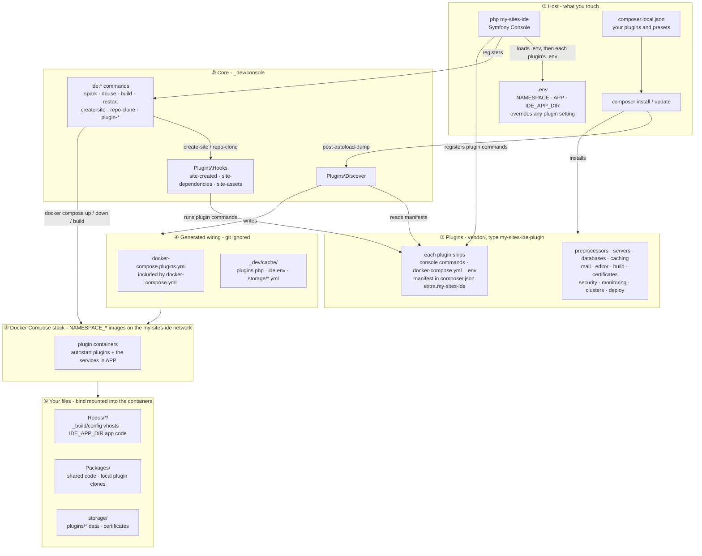
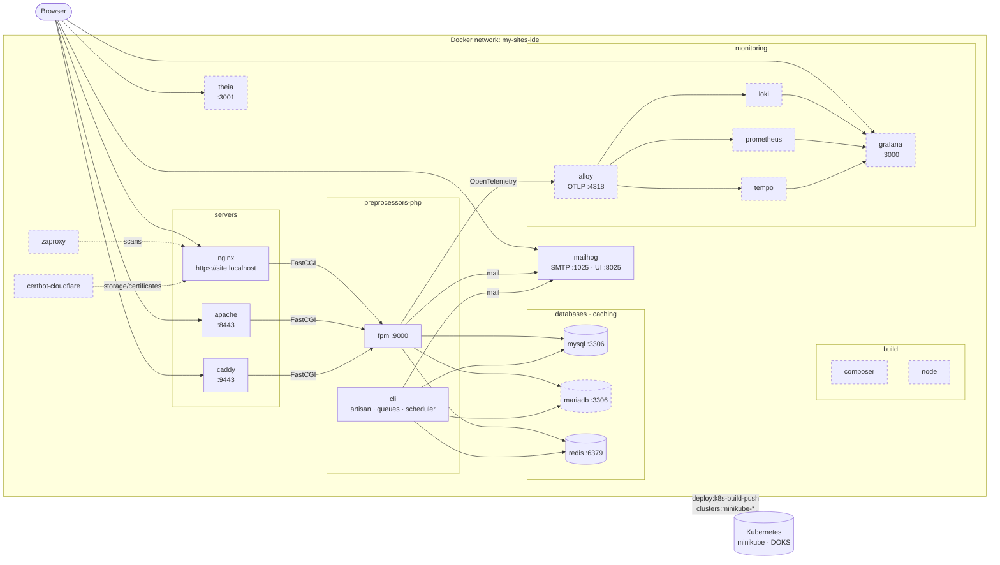

# Architecture

my-sites-ide is a thin core - a Symfony Console app - that every service plugs into. Plugins are Composer packages: installing one is enough for its commands, containers and settings to join the IDE, with no core file edited.

## Component layers

1. **Host** - you run `php my-sites-ide`, and `composer install`/`update` with your plugins listed in `composer.local.json`. The root `.env` sets `NAMESPACE`, `APP` and `IDE_APP_DIR`, and overrides any plugin's setting.
2. **Core** - the `ide:*` commands, `Plugins\Discover`, which runs on Composer's `post-autoload-dump`, and `Plugins\Hooks`, which runs plugin commands on IDE events.
3. **Plugins** - Composer packages of type `my-sites-ide-plugin` in `vendor/`, each with a manifest in its `composer.json` (see [Writing a plugin](writing-a-plugin.md)).
4. **Generated wiring** - Discover writes `docker-compose.plugins.yml` and `_dev/cache/`, so `docker compose` and the CLI see every installed plugin.
5. **Docker Compose stack** - the autostart plugins plus the services in `APP`, built as `<NAMESPACE>_*` images on the `my-sites-ide` network.
6. **Your files** - `Repos/`, `Packages/` and `storage/`, bind mounted into the containers.

## Runtime - the containers

A typical stack once `ide:spark` is up. Solid boxes start by default (or via `APP`), dashed ones run on demand.

## Certificates

Sites use the IDE's self-signed certificate (`_dev/environment/servers/ssl/`) unless a certificate plugin issues a real one. Those plugins share one store, `storage/certificates/`, in the Let's Encrypt layout (`live/<domain>/fullchain.pem` linking into `archive/`). The [nginx plugin](https://github.com/yiendos/my-sites-ide-servers-nginx) always mounts it, at `/etc/nginx/ssl/live` and `/etc/nginx/ssl/archive`. Without a certificate plugin it's just empty (`ide:spark` creates it), so nginx starts either way. With [yiendos/my-sites-ide-certificates-certbot-cloudflare](https://github.com/yiendos/my-sites-ide-certificates-certbot-cloudflare) installed, `certificates:certbot-create <domain>` fills it, replacing the old `ide:ssl`.
