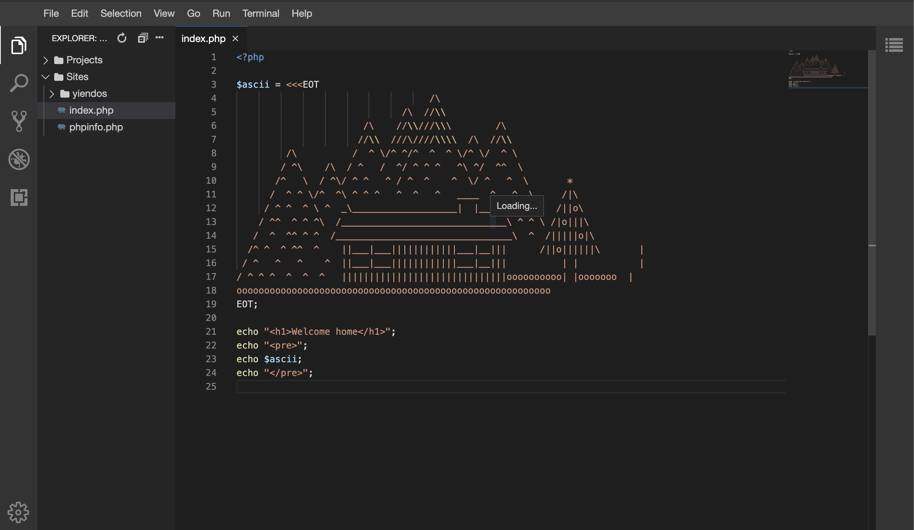

# Getting started



my-sites-ide condenses over 8 years of experience working with Docker into one lean code base. There are many features:

* Modular - pick which services you require - Nginx, Apache or Caddy, MySQL or MariaDB, Redis - all as [plugins](plugins.md)
* Small image size, all images < 200mb - Yet still contain all the php goodies you require for most PHP websites including Laravel.
* Blazingly fast build, CI, deployment of containers - Because of the small image sizes, all waiting times are reduced
* Configurable, the main .env can override the settings of all the docker containers being run

my-sites-ide gives you full control over how your sites are run, failing that you are free to modify the original Dockerfiles for total configuration-city

You can run the same images for your local environment, CI/CD/ staging/ and production environments you can be assured of perfect results everytime.

## Installation

* `git clone git@github.com:yiendos/my-sites-ide.git`

* `cd my-sites-ide`

* `cp env-example .env`

* `cp composer.local-example.json composer.local.json` - your plugins, including the web server ([nginx](https://github.com/yiendos/my-sites-ide-servers-nginx) by default)

* `composer install`

* `php my-sites-ide ide:build`

Now you can access your default homepage:

* https://default.localhost/ [nginx, with the [nginx plugin](https://github.com/yiendos/my-sites-ide-servers-nginx) installed]

* https://default.localhost:8443/ [apache, with the [apache plugin](https://github.com/yiendos/my-sites-ide-servers-apache) installed]

## See available commands

`php my-sites-ide`

```
Console Tool

Usage:
  command [options] [arguments]

Options:
  -h, --help            Display help for the given command. When no command is given display help for the list command
      --silent          Do not output any message
  -q, --quiet           Only errors are displayed. All other output is suppressed
  -V, --version         Display this application version
      --ansi|--no-ansi  Force (or disable --no-ansi) ANSI output
  -n, --no-interaction  Do not ask any interactive question
  -v|vv|vvv, --verbose  Increase the verbosity of messages: 1 for normal output, 2 for more verbose output and 3 for debug

Available commands:
  completion       Dump the shell completion script
  help             Display help for a command
  list             List commands
 ide
  ide:build        Build the containers you wish
  ide:create-site  Create a new Laravel site, with my-site-ide integration
  ide:douse        Finished, until next time? Bring the containers down
  ide:restart      Cloned a new site, or made configuration changes? Restart the IDE
  ide:spark        Spark your creativity to life, by bringing the IDE up
```

For help and guidance relating to any command

`php my-sites-ide [command:subcommand] --help`

## Background to modular docker containers

In terms of running containers on the IDE you have the choice of:

* PHP-FPM and PHP-CLI (plugin: [yiendos/my-sites-ide-preprocessors-php](https://github.com/yiendos/my-sites-ide-preprocessors-php)) - fpm serves your sites, cli runs artisan, queues and background jobs
* Nginx (plugin: [yiendos/my-sites-ide-servers-nginx](https://github.com/yiendos/my-sites-ide-servers-nginx))
* Apache (plugin: [yiendos/my-sites-ide-servers-apache](https://github.com/yiendos/my-sites-ide-servers-apache))
* Caddy (plugin: [yiendos/my-sites-ide-servers-caddy](https://github.com/yiendos/my-sites-ide-servers-caddy))
* MailHog (plugin: [yiendos/my-sites-ide-mail-mailhog](https://github.com/yiendos/my-sites-ide-mail-mailhog)) - catches the mail your sites send, http://localhost:8025
* MySQL (plugin: [yiendos/my-sites-ide-databases-mysql](https://github.com/yiendos/my-sites-ide-databases-mysql)) - sites connect to `mysql:3306`
* MariaDB (plugin: [yiendos/my-sites-ide-databases-mariadb](https://github.com/yiendos/my-sites-ide-databases-mariadb)) - sites connect to `mariadb:3306`
* Redis (plugin: [yiendos/my-sites-ide-caching-redis](https://github.com/yiendos/my-sites-ide-caching-redis)) - sites connect to `redis:6379`
* Theia (plugin: [yiendos/my-sites-ide-editor-theia](https://github.com/yiendos/my-sites-ide-editor-theia)) - an IDE in the browser with PHP debugging, http://localhost:3001

A default list of Applications are defined in the `./env` file:

`APP="theia"`

And these are the default containers that will run when you invoke:

`php my-sites-ide ide:spark`

Plugins marked autostart - PHP, the web servers (nginx, apache, caddy), MySQL, Redis, MailHog - start alongside them on their own, so they don't need listing in `APP`. A service in `APP` that no longer exists (e.g. `cron`, which the PHP plugin folded into `cli`) is skipped with a warning.

To change the default behaviour add or remove containers from the `./env` file or provide further options via the spark command:

`php my-sites-ide ide:spark --app="fpm nginx"`

## Next steps

Make things more interesting by installing a Laravel site:

`php my-sites-ide ide:create-site example`

Run through the normal install steps...

This will create a new Laravel instance under `./Repos/example/deploy`

```
└── Repos
   └── example
      ├── _build
      │   └── config
      └── Projects
      └── deploy
```

Then access your brand new Laravel site:

* https://example.localhost [nginx plugin]

* https://example.localhost:8443 [apache plugin]

To configure the site, or host your own repositories, see [Sites](sites.md).
